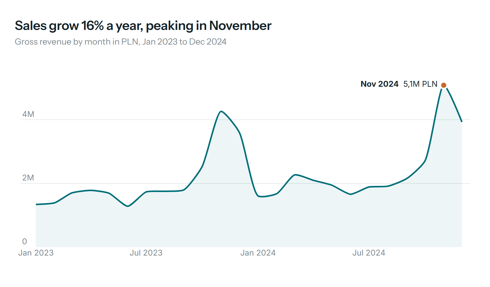
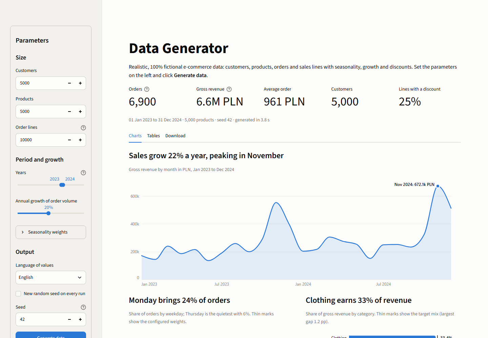
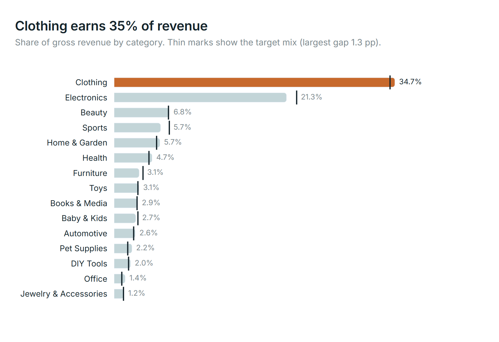

# Data Generator

Generates realistic, 100% fictional e-commerce data for data analysis practice: customers, products, orders and
joined sales lines with seasonality, year-over-year growth, discounts and a configurable category mix.



## Why

Practicing analytics on real shop data is rarely possible: it is private, and public sets are small or too clean.
This generator produces a Polish e-commerce dataset that behaves like a real shop: November spikes, Sunday and Monday
peaks, a long tail of products and discounts that cluster around Black Friday. Every rule lives in plain Python
settings files, so you can change the market and get a new dataset in about 35 seconds.

## What it does

- Generates four tables: `customer_data`, `product_data`, `order_data` and `sales_data` (orders joined with
  customers and products), saved as Parquet or CSV.
- Draws order dates with monthly and weekday seasonality, random noise and an annual growth rate.
- Builds a product catalog with a six-level hierarchy (category, subcategory, product type, brand, series, model),
  price and margin ranges per product type, brand share tiers and long-tail product popularity.
- Steers the revenue mix by category, adds category seasonality (toys in December, sports in summer), multi-line
  orders, quantity profiles and discounts that get deeper in November and December.
- Writes display values in English or Polish (`data_language`) and gives identical output for the same seed.
- Comes with a web app (Dash with Mantine): set the parameters, look at the tables and charts, then download CSV,
  Parquet or a ZIP with all tables.

## Quickstart

Tested with Python 3.11.

```bash
python -m venv .venv
source .venv/bin/activate        # Windows: .venv\Scripts\activate
pip install -r requirements.txt
python main.py
```

### Command line

The default run (seed 42) writes four Parquet files to `export/`: 40,000 customers, 50,000 products and 80,000 order
lines in 55,123 orders from 2023 and 2024. Volumes, years, seasonality, language and output format are set in
`settings/main_settings.py`. The market itself (categories, brands, prices, margins, discounts, payments and
deliveries) is defined in `settings/market_settings.py` and `settings/product_catalog.py`. Every option is described
in [docs/settings.md](docs/settings.md).

### App

```bash
python -m ui.app
```

The app opens at http://127.0.0.1:8050 and reads from top to bottom in four steps. Pick a size (Small, Medium or
Large, each with its generation time) or type your own numbers, set the years and the annual growth and click
**Generate data**. Language, seed and seasonality weights sit under **Advanced**; drag the points of the month and
weekday charts up or down to shape the seasonality, or type exact values. The page moves on to the headline
numbers and a preview of each table, then the charts, then the downloads. Medium (5,000 customers, 5,000 products and
10,000 order lines) takes about 4 seconds; Large (the command-line volumes) takes about half a minute and shows a
progress bar. The same seed and parameters always give the same data.



## Data

All people, e-mails, phone numbers, bank account numbers, products, prices and sales are synthetic: generated by
`func/` with [Faker](https://faker.readthedocs.io/) (`pl_PL`) and NumPy, seed 42. E-mail addresses use the reserved
domains `example.com`, `example.org` and `example.net`.

Brand names (for example Samsung, Apple, H&M and Reserved) are used only as labels to make the catalog look
familiar. Products, prices, margins, popularity and market shares are fictional and say nothing about these
companies.

Customer addresses take a real postal code and its main locality from `source/pl_postal_code.csv` (20,553 Polish
postal codes, 3,413 localities). Each code is drawn with a weight equal to its number of addresses. Addresses count
buildings rather than residents, so cities with large apartment blocks get fewer customers than their population
would suggest: Warsaw has about 1.5% of customers.

Source: [ZnajdzKod.pl](https://znajdzkod.pl/baza-kodow-pocztowych/) na podstawie PRG (GUGiK) i TERYT (GUS),
stan 16.09.2026. The site allows downloading, processing and publishing its files with this attribution.
`scripts/build_postal_codes.py` rebuilds the file from `kody-pocztowe.csv`.

## Results

The charts come from the default settings. The app draws the same charts from whatever you generate; `python scripts/make_charts.py` rebuilds these images
with headless Chrome or Edge.


The weekday mix stays within a percentage point or two of `base_weekday_seasonality`, with deliberate random noise.



Category revenue lands close to `category_revenue_target_weights`. The generator corrects for average price, so
expensive categories do not take over revenue just because their unit prices are high.

## Project structure

```
main.py              command-line entry point
ui/                  web app (Dash with Mantine): layout, charts, theme, fonts
func/                generation steps, plus service.py (app parameters), charts.py and export.py
settings/            all parameters: volumes, seasonality, market, product catalog, translations
source/              postal codes with localities and address counts
scripts/             postal code import and chart rendering for this README
notebooks/           exploratory analysis (outputs cleared; run main.py first)
docs/                settings guide and README images
tests/               pytest suite
```

## Tests

```bash
pip install -r requirements-dev.txt
python -m pytest
```

96 tests cover table shapes and types, value ranges, unique IDs and e-mails, joins between tables, reproducibility
with a seed, monthly and weekday seasonality, year-over-year growth, postal code weighting, localization, the
settings validators, app parameters, size presets and draggable weights, exports, the on-screen number format,
chart data, the app's charts and downloads and a request to the running app. They take about 10 seconds on small
volumes.

## License

MIT, see [LICENSE](LICENSE).
