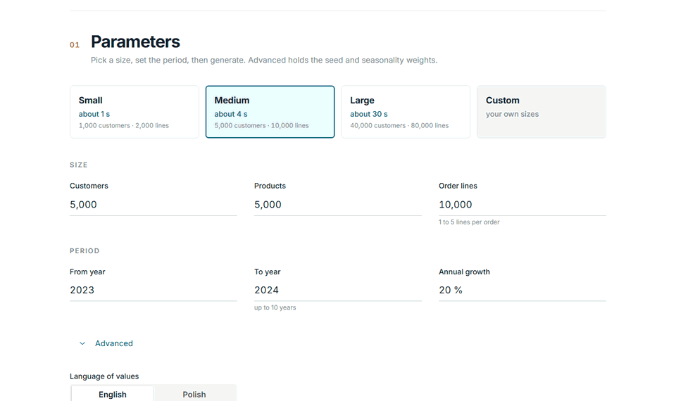
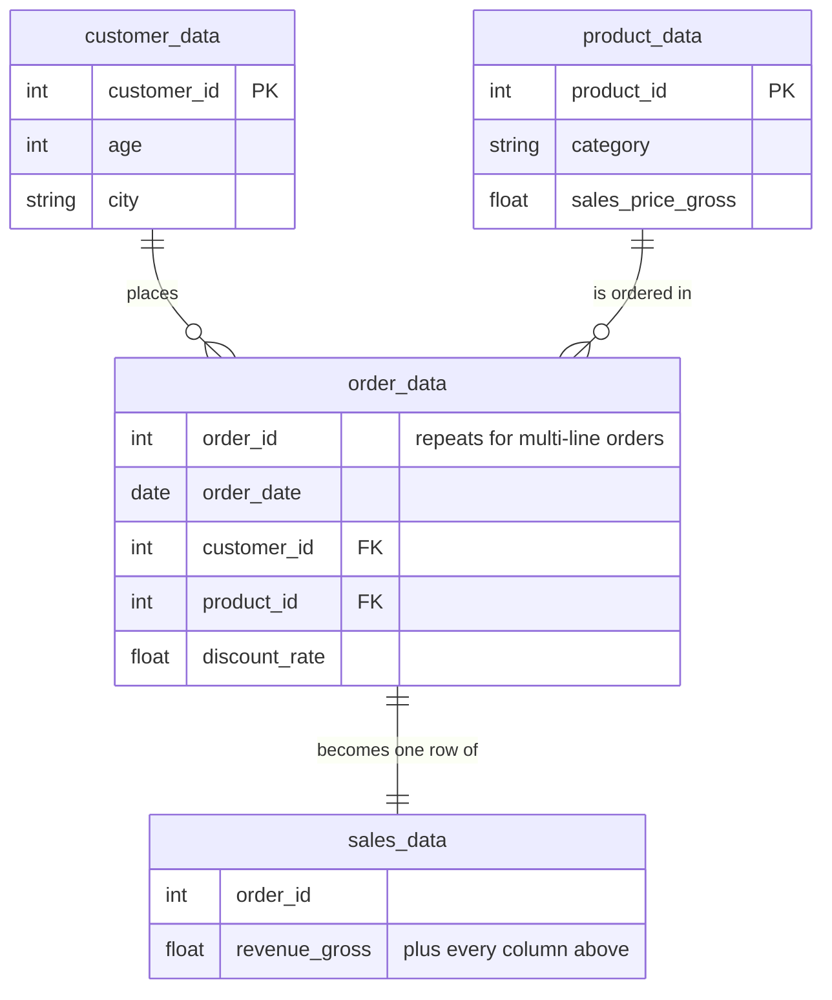

# Data Generator

[](https://github.com/tlabedzki/Data-Generator/actions/workflows/tests.yml)


[](https://github.com/tlabedzki/Data-Generator/releases)

Generates a realistic, fully fictional Polish e-commerce dataset (customers, products, orders and sales) from the
command line or a web app.



**Stack:** Python · pandas · NumPy · Faker · Dash with Mantine · Plotly · pytest

## Why

Real shop data is private, and public sets are small or too clean. Data Generator gives analysts, trainers and BI
teams a shop that behaves like a real one: November spikes, Sunday and Monday peaks, a long tail of products and
discounts that cluster around Black Friday. Change the rules in the app or in plain Python settings and get a new
dataset in seconds, with no real personal data.

## What it does

- Generates four linked tables (customers, products, orders and joined sales lines) as Parquet or CSV.
- Shapes order dates with monthly and weekday seasonality, random noise and annual growth.
- Builds a six-level product catalog with price and margin ranges, brand tiers and a long tail of popularity.
- Steers the category revenue mix and adds category seasonality, multi-line orders and deeper discounts in
  November and December.
- Writes values in English or Polish and returns identical output for the same seed.

<!-- generated:sample -->

| order_date | order_id | category | product_name | quantity | revenue_gross | city |
|---|---|---|---|---|---|---|
| 2023-01-01 | 100001 | Health | Vitamin Supplement Naturell Daily D3 | 1 | 239.00 | Kolbuszowa |
| 2023-11-09 | 118306 | Clothing | Sneakers Puma Rider Future | 3 | 1,122.75 | Pogorzelec |
| 2024-06-29 | 136733 | Baby & Kids | Diapers Pampers Premium Care | 1 | 169.00 | Karsin |

Three of the 80,000 rows of `sales_data` from the default run with English values. The table has 35 columns: each
order line joined with its customer and product.

<!-- /generated:sample -->

## Results

Every chart and number below comes from the default run (seed 42). `python scripts/make_charts.py` regenerates the
data, redraws the charts in light and dark versions and rewrites the numbers in this README;
`python scripts/make_demo_gif.py` records the demo GIF at the top.

<!-- generated:results -->

<picture>
  <source media="(prefers-color-scheme: dark)" srcset="docs/img/monthly-revenue-dark.png">
  
</picture>

Revenue grows 16% a year and peaks at 5.1M PLN in November 2024, the Black Friday month.

<picture>
  <source media="(prefers-color-scheme: dark)" srcset="docs/img/weekday-profile-dark.png">
  
</picture>

Every weekday lands within 1.4 percentage points of its configured weight; the rest is deliberate random noise.

<picture>
  <source media="(prefers-color-scheme: dark)" srcset="docs/img/category-mix-dark.png">
  
</picture>

Category revenue lands within 1.3 percentage points of the target mix: the generator corrects for average price, so
expensive categories do not take over revenue just because their unit prices are high.

The table checks patterns that the charts do not show, against the settings that drive them.

| Pattern | Settings | Default run |
|---|---|---|
| November share of order lines | 18.6% (`base_monthly_seasonality`) | **17.2%** |
| Order lines in 2024 vs 2023 | +20% (`annual_growth_rate`) plus noise | **+17.6%** |
| Orders with more than one line | 30% (`order_line_number`) | **31%** |
| Discounted lines, November vs Jan–Oct | ×1.65 (`discount_monthly_multiplier`) | **35% vs 22%** |
| Revenue from the top 20% of products | long tail (`product_popularity_sigma` = 1.10) | **86%** |

<!-- /generated:results -->

## Quickstart

You need Git and Python 3.11. Clone the repository:

```bash
git clone https://github.com/tlabedzki/Data-Generator.git
cd Data-Generator
```

Create and activate a virtual environment. Naming the version picks Python 3.11 even if another one is the default.

| Step | Windows (PowerShell) | macOS and Linux |
|---|---|---|
| Create | `py -3.11 -m venv .venv` | `python3.11 -m venv .venv` |
| Activate | `.venv\Scripts\Activate.ps1` | `source .venv/bin/activate` |
| Check | `python --version` prints `Python 3.11.x` | `python --version` prints `Python 3.11.x` |

If PowerShell says that running scripts is disabled, run `Set-ExecutionPolicy -Scope CurrentUser RemoteSigned` once
and activate again. Then install the packages and start the app:

```bash
pip install -r requirements.txt
python -m ui.app
```

Open http://127.0.0.1:8050 in your browser. The app starts at step 1, the parameters; press Ctrl+C in the terminal to
stop it.

### Command line

<!-- generated:cli -->

`python main.py` writes 40,000 customers, 50,000 products and 80,000 order lines (55,123 orders in 2023 and 2024) as
Parquet to `export/` in about half a minute, with seed 42 and Polish values by default.

<!-- /generated:cli -->

Volumes and seasonality live in `settings/main_settings.py`, the market in `settings/market_settings.py` and
`settings/product_catalog.py`; [docs/settings.md](docs/settings.md) describes every option.

### App

The app walks you through four steps: parameters, preview, charts and downloads. Pick a size (Medium takes about
4 seconds, Large about half a minute), set the years and growth, and drag the month and weekday points under
**Advanced** to shape the seasonality. Values come in English or Polish, and the same seed and parameters always give
the same data.

## Data

All people, e-mails, phone numbers, bank account numbers, products, prices and sales are synthetic: generated by
`func/` with [Faker](https://faker.readthedocs.io/) (`pl_PL`) and NumPy, seed 42. E-mail addresses use the reserved
domains `example.com`, `example.org` and `example.net`.



Each row of `order_data` is one order line; `sales_data` joins it with its customer and product and adds the
discounted prices and `revenue_gross`.

Brand, payment and delivery names (for example Samsung, H&M, PayU, BLIK and InPost) are used only as labels to make
the data look familiar. Products, prices, margins, popularity and market shares are fictional and say nothing about
these companies.

Customer addresses take a real postal code and its main locality from `source/pl_postal_code.csv` (20,553 Polish
postal codes, 3,413 localities), drawn with a weight equal to the number of addresses. Addresses count buildings
rather than residents, so cities with large apartment blocks get fewer customers than their population would
suggest: Warsaw has about 1.5% of customers.

Source: [ZnajdzKod.pl](https://znajdzkod.pl/baza-kodow-pocztowych/) na podstawie PRG (GUGiK) i TERYT (GUS),
stan 16.09.2026 (attribution in Polish, as required by the source). The site allows downloading, processing and
publishing its files with this attribution; `scripts/build_postal_codes.py` rebuilds the file from
`kody-pocztowe.csv`.

## Project structure

<details><summary>Show the tree</summary>

```
main.py              command-line entry point
ui/                  web app (Dash with Mantine): layout, charts, draggable weights, theme, fonts
func/                generation steps, plus service.py (app parameters), charts.py, export.py and number_format.py
settings/            all parameters: volumes, seasonality, market, product catalog, translations
source/              postal codes with localities and address counts
scripts/             postal code import, README charts and numbers, demo GIF recorder
notebooks/           exploratory analysis (outputs cleared; run main.py first)
docs/                settings guide and README images
tests/               pytest suite
```

</details>

## Tests

```bash
pip install -r requirements-dev.txt
python -m pytest
```

106 pytest tests (about 10 seconds) check table shapes, joins, seed reproducibility, seasonality and growth against
the settings, exports and the running app.

## License

MIT, see [LICENSE](LICENSE). [Changelog](CHANGELOG.md).
