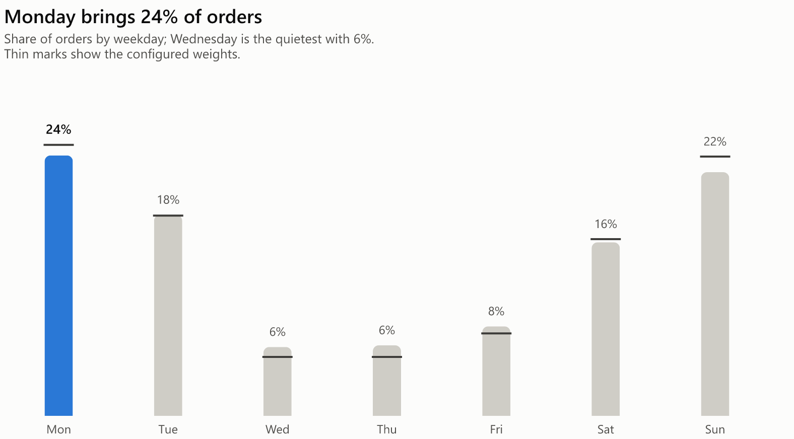
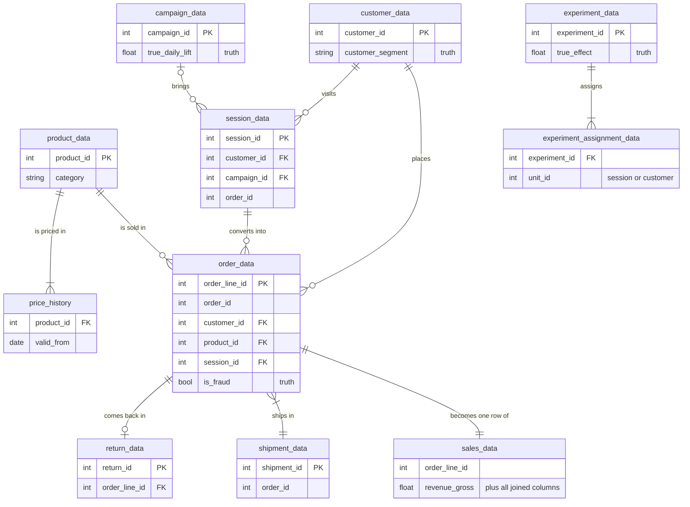

# Data Generator

[](https://github.com/tlabedzki/Data-Generator/actions/workflows/tests.yml)


[](https://github.com/tlabedzki/Data-Generator/releases)

Generates a fully fictional Polish online shop as 13 linked tables, from orders to web sessions, returns and A/B
tests, for analytics practice.


**Stack:** Python · pandas · NumPy · Faker · Dash with Mantine · Plotly · pytest

## Why

Real shop data is private, and public sets are small, too clean or missing the answer. Data Generator gives
analysts, trainers and BI teams a shop that behaves like a real one: customers who come back or churn, Black Friday
peaks, baskets of products bought together, campaigns that move traffic and A/B tests with a known true effect.
Truth columns hold the right answer, so you can check your analysis, and a Large dataset takes about 5 seconds.

## What you can analyse

Each row starts with a question a shop asks; the last column says where the true answer sits.

| Question | Method and tables | Answer to check against |
|---|---|---|
| How fast do sales grow, and how big is the November peak? | Seasonality and forecasting on `sales_data` | `annual_growth_rate`, `base_monthly_seasonality`, `special_days` in `settings/` |
| Which customers come back, and which churn and when? | Cohort retention, RFM and customer value on `customer_data`, `sales_data` | `customer_segment` |
| Which products are bought together? | Market basket analysis (support, confidence, lift) on `sales_data` | `complements` in `settings/basket_settings.py` |
| Which channel brings the orders, and did the campaign pay for itself? | Funnel, attribution and ROAS on `session_data`, `campaign_data`, `order_data` | `true_daily_lift` per campaign |
| Is the A/B test result real? | Significance test, confidence interval, sample ratio mismatch and A/A test on `experiment_data`, `experiment_assignment_data`, `session_data` | `true_effect`, `has_sample_ratio_mismatch` |
| Do discounts sell more, and what drives returns and late deliveries? | Price elasticity, promotion uplift, return and delivery rates on `sales_data`, `price_history`, `return_data`, `shipment_data` | settings in `docs/settings.md` |
| Which orders are fraud, and when did the shop go down? | Fraud and anomaly detection on `order_data`, `anomaly_data` | `is_fraud`, `anomaly_data` |
| Can you trust the data before you analyse it? | Data cleaning (missing values, typos, formats, outliers, duplicates) on every table at `data_quality_level` low, medium or high | `quality_issue_data` (clean values) |

Section 12 of the notebook in `notebooks/` covers seasonality and section 18 walks through the advanced tables.

## What it does

- Generates 13 linked tables: customers, products, order lines, sales lines, price history, shipments, returns,
  campaigns, web sessions, experiments, experiment assignments, anomalies and data quality issues.
- Models customers over time: signup cohorts, segments, churn, preferred categories, replenishment and products
  bought together.
- Shapes demand with monthly and weekday seasonality, special days, hours of the day, price changes, discounts that
  sell more units, returns and late deliveries in the peak season.
- Adds channels, campaigns, devices and a session funnel, plus labelled fraud, shop outages and optional dirty data
  (missing values, typos, formats, outliers, duplicates).
- Saves CSV or Parquet with values in English or Polish; the same seed gives identical files.

<!-- generated:sample -->

| order_date | order_id | category | product_name | quantity | revenue_gross | city |
|---|---|---|---|---|---|---|
| 2023-01-01 | 100001 | Electronics | Laptop Acer Aspire 7 | 2 | 17,258.00 | Raniżów |
| 2023-11-12 | 118437 | Health | Pain Relief Apap Classic Tablets | 1 | 36.80 | Rozgarty |
| 2024-06-29 | 136910 | Toys | Doll Barbie Dreamtopia Princess | 1 | 619.00 | Liszki |

Three of the 80,339 rows of `sales_data` from the default run with English values. The table has 53 columns: each
order line joined with its customer and product.

<!-- /generated:sample -->

## Results

Every chart and number below comes from the default run (seed 42). `python scripts/make_charts.py` regenerates the
data, redraws the charts in light and dark versions and rewrites the numbers in this README;
`python scripts/make_demo_gif.py` records the demo GIF at the top.

<!-- generated:results -->

<picture>
  <source media="(prefers-color-scheme: dark)" srcset="docs/img/monthly-revenue-dark.png">
  
</picture>

Revenue grows 21% a year and peaks at 5.0M PLN in November 2024, the Black Friday month.

<picture>
  <source media="(prefers-color-scheme: dark)" srcset="docs/img/weekday-profile-dark.png">
  
</picture>

Every weekday lands within 2.9 percentage points of its configured weight; the rest is deliberate random noise.

<picture>
  <source media="(prefers-color-scheme: dark)" srcset="docs/img/category-mix-dark.png">
  
</picture>

Category revenue lands within 2.8 percentage points of the target mix: the generator corrects for average price, so
expensive categories do not take over revenue just because their unit prices are high.

Beyond the charts, 52 of 52 realism criteria pass on the same run. The table shows ten of them; the list under it
shows all.

| What a real shop does | Default run |
|---|---|
| Orders grow year over year (setting: 20% a year) | **19%** |
| Black Friday 2024 against an average November day | **3.5x** |
| Christmas Day 2024 against an average December day | **0.30x** |
| Revenue from the top 10% of customers | **68%** |
| Cohort retention after 1 and 12 months | **11.6% / 5.6%** |
| Lift of laptop and wireless mouse in one basket (orders) | **14.2 (50 orders)** |
| Return rate, Clothing against Electronics | **26.9% / 6.1%** |
| Social orders on social campaign days against other days | **2.82x** |
| A/B test with a true +10% lift: measured lift and 95% CI | **+11.1% [+2.9%, +19.9%]** |
| Labelled fraud orders: value against other orders (orders) | **15.4x (221 fraud orders)** |

<details><summary>All 52 realism criteria (52 pass)</summary>

**Dirty data and anomalies**

- ✅ missing phone_number at medium (expected 1200): 1244
- ✅ missing city at medium (expected 600): 615
- ✅ missing age at medium (expected 600): 620
- ✅ duplicate customers at medium (expected 3% of customers): 1200
- ✅ missing values at none / issues listed: 0 / 0
- ✅ fraud order value / other orders: 15.4x (221 fraud orders)
- ✅ fraud orders shipped to another postal code: 100%
- ✅ orders on outage day 2023-09-04 vs median day: 4%
- ✅ orders on outage day 2024-09-23 vs median day: 7%

**Customer behaviour**

- ✅ cohort retention month 1 / month 12: 11.6% / 5.6%
- ✅ orders per customer: variance / mean: 5.24
- ✅ revenue share of the top 10% customers: 68%
- ✅ revenue per customer loyal / occasional: 3,836 / 745 PLN
- ✅ Electronics share of lines, age < 30 / 55+: 5.3% / 2.9%
- ✅ November share of orders vs the calendar (no flattening): 17.8% vs 17.6% (+0.2 pp)
- ✅ November weight over 10 seeds vs setting (noise has no bias): 18.5% vs 18.6% (-0.1 pp)
- ✅ order growth first to last year (setting 20%/year): 19%

**Prices, promotions, returns and shipping**

- ✅ Black Friday 2023-11-24 / average November day: 3.2x
- ✅ 25 December 2023 / average December day: 0.31x
- ✅ Black Friday 2024-11-29 / average November day: 3.5x
- ✅ 25 December 2024 / average December day: 0.30x
- ✅ busiest hour of the day: 20:00 (9.7% of orders)
- ✅ units per line with / without discount: 1.97 / 1.59
- ✅ return rate Clothing / Electronics: 26.9% / 6.1%
- ✅ bulky orders in lockers / furniture lines to parcel lockers: 0.0% / 0.0% (was 55.6%)
- ✅ lines sold before launch or after discontinuation: 0
- ✅ line price differs from price_history on the order day (2000 lines): 0
- ✅ products with at least one list price change: 80%
- ✅ late deliveries outside / in November-December: 5.8% / 25.8%

**Basket and preferences**

- ✅ lift Laptop + Wireless Mouse: 14.2 (50 orders)
- ✅ lift Smartphone + Headphones: 8.6 (105 orders)
- ✅ lift Office Desk + Office Chair: 65.5 (11 orders)
- ✅ lift Cat Food + Pet Litter (litter is bought by cat owners anyway): 3.0 (115 orders)
- ✅ same first category as the previous order / at random: 36.7% / 17.8%
- ✅ median days between repeat purchases of the same pet food: 29 (1574 repeats)
- ✅ median unit price premium / budget customers: 279 / 179 PLN
- ✅ lines from the customer's preferred category: 42%

**Marketing and traffic**

- ✅ orders with a converting session: 100.0% (690,155 sessions)
- ✅ largest relative gap of conversion vs setting (channel x device): 2.5% (email 14.2%)
- ✅ mobile share of sessions: 61.9% vs 62%
- ✅ social share of orders on social campaign days / other days: 2.82x
- ✅ ROAS by channel (attributed revenue / cost): affiliate 5.1, email 20.0, paid_search 5.9, social 8.0
- ✅ marketing cost per order: 70 PLN vs 70
- ✅ carts abandoned (sessions with a cart and no order / all carts): 72%

**A/B experiments**

- ✅ checkout_redesign: sample ratio test p-value (mismatch planted: False): 0.042 (B 49.4%)
- ✅ checkout_redesign: conversion lift, 95% CI (true +10%): +11.1% [+2.9%, +19.9%]
- ✅ recommendation_widget: sample ratio test p-value (mismatch planted: False): 0.048 (B 52.1%)
- ✅ recommendation_widget: units per line B - A, 95% CI (true +0.12): +0.144 [+0.074, +0.213]
- ✅ free_shipping_banner: sample ratio test p-value (mismatch planted: True): 1.1e-32 (B 46.3%)
- ✅ free_shipping_banner: conversion lift, 95% CI (true +6%): +8.8% [+0.8%, +17.5%]
- ✅ search_ranking_aa: sample ratio test p-value (mismatch planted: False): 0.37 (B 50.3%)
- ✅ search_ranking_aa: conversion lift, 95% CI (true +0%): -0.9% [-9.8%, +8.9%]

`python scripts/check_realism.py` runs the same criteria and exits with 1 when any of them fails.

</details>

<!-- /generated:results -->

## Quickstart

You need Git and Python 3.11. Clone the repository:

```bash
git clone https://github.com/tlabedzki/Data-Generator.git
cd Data-Generator
```

Create and activate a virtual environment. Naming the version picks Python 3.11 even if another one is the default.

| Step | Windows (PowerShell) | macOS and Linux |
|---|---|---|
| Create | `py -3.11 -m venv .venv` | `python3.11 -m venv .venv` |
| Activate | `.venv\Scripts\Activate.ps1` | `source .venv/bin/activate` |
| Check | `python --version` prints `Python 3.11.x` | `python --version` prints `Python 3.11.x` |

If PowerShell says that running scripts is disabled, run `Set-ExecutionPolicy -Scope CurrentUser RemoteSigned` once
and activate again. Then install the packages and start the app:

```bash
pip install -r requirements.txt
python -m ui.app
```

Open http://127.0.0.1:8050 in your browser. The app starts at step 1, the parameters; press Ctrl+C in the terminal to
stop it.

### Command line

<!-- generated:cli -->

`python main.py` writes 40,000 customers, 50,000 products and 80,339 order lines (55,568 orders in 2023 and 2024) with
seed 42 and Polish values, and saves 13 tables as Parquet files in `export/`.

<!-- /generated:cli -->

It takes about 7 seconds on a laptop. Every option lives in `settings/` and [docs/settings.md](docs/settings.md)
describes it; `data_quality_level` in `settings/quality_settings.py` turns on dirty data.

### App

The app walks you through four steps: parameters, preview, charts and downloads. Pick a size (Small under a second,
Medium about 1 second, Large about 5 seconds), set the years and growth, and open **Advanced** for the seed, the dirty
data level and the month and weekday weights, which you drag. Every table downloads as CSV, which opens anywhere,
Excel included, or as Parquet, one by one or as a ZIP.

## Data

All people, e-mails, phone numbers, bank account numbers, products, prices and sales are synthetic: generated by
`func/` with [Faker](https://faker.readthedocs.io/) (`pl_PL`) and NumPy, seed 42. E-mail addresses use the reserved
domains `example.com`, `example.org` and `example.net`.



Each row of `order_data` is one order line. The two remaining tables, `anomaly_data` and `quality_issue_data`, point
at rows of the others by table name and key. The columns marked "truth" hold what an analysis should find; the
[output files table](docs/settings.md#output-files) says what one row of each table is.

Brand, payment and delivery names (for example Samsung, H&M, PayU, BLIK and InPost) are used only as labels to make
the data look familiar. Products, prices, margins, popularity and market shares are fictional and say nothing about
these companies.

Customer addresses take a real postal code and its main locality from `source/pl_postal_code.csv` (20,553 Polish
postal codes, 3,413 localities), drawn with a weight equal to the number of addresses. Addresses count buildings
rather than residents, so cities with large apartment blocks get fewer customers than their population would
suggest: Warsaw has about 1.5% of customers.

Source: [ZnajdzKod.pl](https://znajdzkod.pl/baza-kodow-pocztowych/) na podstawie PRG (GUGiK) i TERYT (GUS),
stan 16.09.2026 (attribution in Polish, as required by the source). The site allows downloading, processing and
publishing its files with this attribution; `scripts/build_postal_codes.py` rebuilds the file from
`kody-pocztowe.csv`.

## Project structure

<details><summary>Show the tree</summary>

```
main.py              command-line entry point
ui/                  web app (Dash with Mantine): layout, charts, draggable weights, theme, fonts
func/                generation steps: customers, products, prices, orders, behaviour, fulfilment, marketing,
                     experiments, anomalies and data quality, plus the app service, charts and exports
settings/            all parameters: volumes, calendar, behaviour, basket, commerce, marketing, experiments, quality
source/              postal codes with localities and address counts
scripts/             realism criteria, README charts and numbers, demo GIF recorder, postal code import
notebooks/           exploratory analysis (outputs cleared; run main.py first)
docs/                settings guide and README images
tests/               pytest suite
```

</details>

## Tests

```bash
pip install -r requirements-dev.txt
python -m pytest
```

172 pytest tests (about 20 seconds) check table shapes, joins, seed reproducibility, seasonality, customer behaviour,
prices and returns, marketing, experiments, dirty data, exports and the running app on small samples.
`python scripts/check_realism.py` checks the realism criteria listed under Results on the full default run.

## License

MIT, see [LICENSE](LICENSE). [Changelog](CHANGELOG.md).
