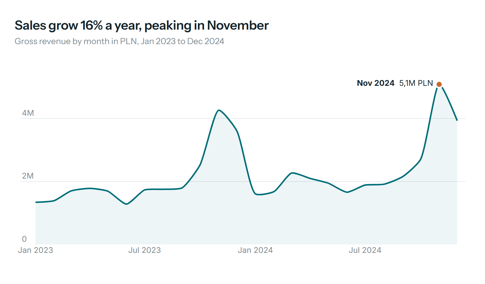
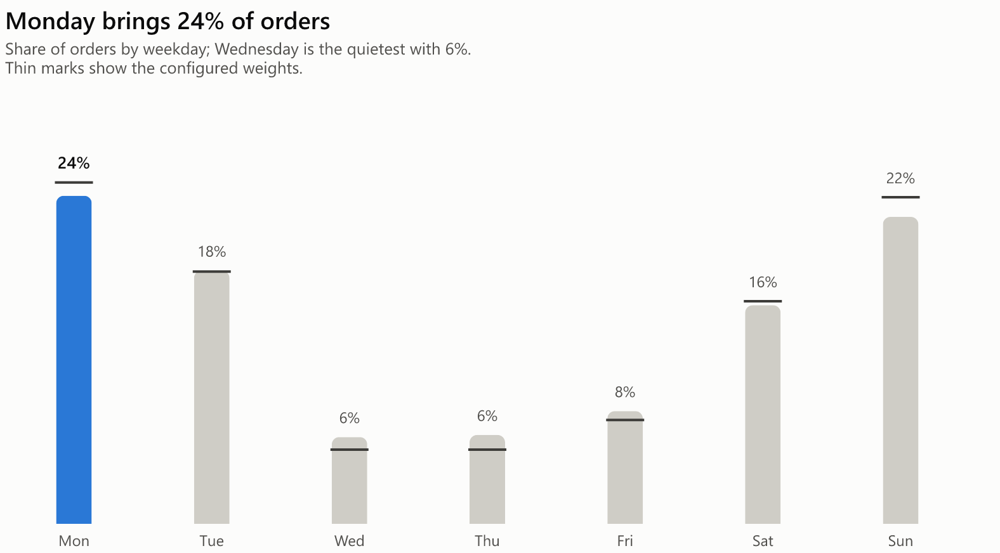
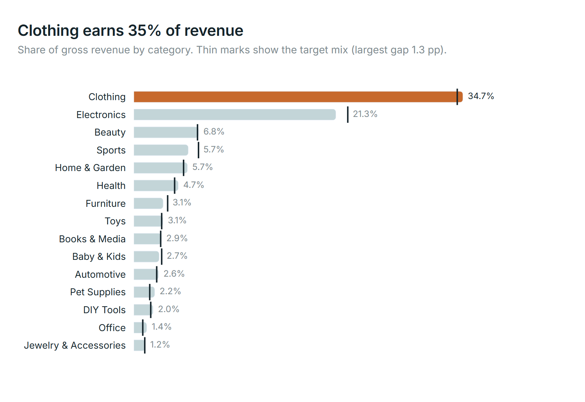

# Data Generator

[](https://github.com/tlabedzki/Data-Generator/actions/workflows/tests.yml)


[](https://github.com/tlabedzki/Data-Generator/releases)
[](README.md)

Generuje dane dla Lumo, w pełni fikcyjnego polskiego sklepu internetowego: 21 powiązanych tabel, od zamówień i opinii
po ceny konkurencji, koszty sklepu, dostawców i stany magazynowe, sesje w serwisie, zwroty i testy A/B. Służy do
ćwiczeń z analityki.

<picture>
  <source media="(prefers-color-scheme: dark)" srcset="docs/img/app-demo-dark.svg">
  
</picture>

**Stack:** Python · pandas · NumPy · Faker · Dash with Mantine · Plotly · pytest

## Po co

Prawdziwe dane sklepów są prywatne, a publiczne zbiory są małe, zbyt czyste albo nie zawierają prawidłowej odpowiedzi.
Data Generator daje analitykom, trenerom i zespołom BI (business intelligence, czyli raporty i dashboardy dla firmy)
sklep, który zachowuje się jak prawdziwy: klientów, którzy wracają albo odchodzą, szczyty w Black Friday (listopadowy
dzień wyprzedaży), koszyki produktów kupowanych razem, anulowane zamówienia, spóźnione paczki kosztujące gwiazdki w
ocenach, kampanie zmieniające ruch oraz testy A/B (A/B tests, czyli eksperymenty, w których losowo wybrana część
klientów widzi nową wersję, a reszta starą) ze znanym prawdziwym efektem. Kolumny prawdy (truth columns) zapisują
prawidłową odpowiedź, więc wynik analizy możesz z nią porównać. Duży zbiór (Large) powstaje w ok. 5 sekund.

## Co możesz analizować

Każdy wiersz zaczyna się od pytania, które zadaje sobie sklep; ostatnia kolumna mówi, gdzie leży prawdziwa odpowiedź.

| Pytanie | Jak odpowiada analiza | Gdzie leży prawdziwa odpowiedź |
|---|---|---|
| Jak szybko rośnie sprzedaż i jak duży jest szczyt w listopadzie? | Sezonowość (seasonality, czyli powtarzalny rytm sprzedaży w roku i w tygodniu) i prognozowanie (forecasting) w `sales_data` | `annual_growth_rate`, `base_monthly_seasonality`, `special_days` w `settings/` |
| Którzy klienci wracają, a którzy odchodzą i kiedy? | Retencja kohort (cohort retention, czyli jaka część klientów z jednego okresu rejestracji kupuje w kolejnych miesiącach), RFM (podział klientów według tego, jak niedawno, jak często i za ile kupują), modele odejść (churn, czyli chwila, w której klient przestaje kupować) i wartości klienta (BG/NBD, model przewidujący, ile zakupów klient jeszcze zrobi) w `customer_data`, `order_data` | `customer_segment`, `true_churn_date`, `true_purchase_rate` |
| Które produkty kupuje się razem? | Analiza koszyka (market basket analysis): wsparcie (support, czyli jak często para produktów trafia do jednego koszyka), ufność (confidence, czyli jak często zakup jednego produktu pociąga zakup drugiego) i lift (ile razy częściej para występuje razem, niż wynikałoby z przypadku) w `sales_data` | `complements` w `settings/basket_settings.py` |
| Który kanał przynosi zamówienia i czy kampania się zwróciła? | Lejek (funnel, czyli kolejne kroki od wejścia na stronę do zamówienia), atrybucja (attribution, czyli przypisanie zamówienia kanałowi, który je przyniósł) i ROAS (przychód z kampanii podzielony przez jej koszt) w `session_data`, `campaign_data`, `order_data` | `true_daily_lift` dla każdej kampanii |
| Które zamówienia nigdy nie stają się przychodem, a które metody płatności zawodzą? | Odsetek anulowań i nieudanych płatności według metody, miesiąca i powodu w `order_data` | `payment_failure_rate`, `cancellation_rate` w `settings/` |
| Czy spóźnione paczki i wadliwe produkty kosztują gwiazdki? | Analiza ocen w `review_data` razem z `shipment_data` (`is_late`) i `return_data` (powody zwrotów) | `review_score_weights` w `settings/` |
| Czy wynik testu A/B jest prawdziwy? | Test istotności (significance test, czyli sprawdzenie, czy różnica nie wynika z przypadku), przedział ufności (confidence interval, czyli zakres, w którym z dużym prawdopodobieństwem leży prawdziwy efekt), niedopasowanie liczebności grup (sample ratio mismatch, czyli sytuacja, gdy grupy testu mają inną liczebność, niż zakładano) i test A/A (obie grupy dostają to samo, więc test nie powinien pokazać różnicy) w `experiment_data`, `experiment_assignment_data`, `session_data` | `true_effect`, `has_sample_ratio_mismatch` |
| Czy nasza cena jest konkurencyjna i gdzie jest wyraźnie powyżej albo poniżej rynku? | Indeks cen (price index, czyli nasza cena podzielona przez medianę cen konkurencji) według produktu, kategorii i sklepu w `competitor_prices`, `product_data`, `price_history` | `competitor_strategy`, `true_price_level`, `true_market_price_gross` |
| Ile naprawdę zarabia każdy produkt po kosztach wysyłki, zwrotów, płatności i prowizji? | Marża na pokrycie (contribution margin, czyli to, co zostaje z przychodu po kosztach zmiennych) według produktu w `sales_data`, `shipment_data`, `return_data`, `payment_data`: rozłóż `carrier_cost` i `payment_fee` na linie zamówień, dodaj koszty zwrotów i `affiliate_commission` | stawki w `settings/commerce_settings.py` (Shop costs); koszty sumują się co do grosza |
| Czy rabaty zwiększają sprzedaż i co powoduje zwroty oraz spóźnione dostawy? | Elastyczność cenowa (price elasticity, czyli o ile zmienia się sprzedaż, gdy zmienia się cena), efekt promocji (promotion uplift, czyli ile więcej sprzedaje się w promocji), odsetek zwrotów i opóźnionych dostaw w `sales_data`, `price_history`, `return_data`, `shipment_data` | ustawienia w `docs/settings.md` |
| Co i kiedy sklep powinien zamówić u każdego dostawcy? | Prognoza popytu (demand forecasting), zapas bezpieczeństwa (safety stock, czyli zapas na wypadek większej sprzedaży albo spóźnionej dostawy) i zasady zamawiania (reorder policy, czyli kiedy i ile zamówić) w `order_data`, `stock_movement_data`, `purchase_order_data`, `product_supplier_data`; test wsteczny (backtest, czyli sprawdzenie zasad na danych z przeszłości) na symulowanym stanie magazynu | `true_lead_time_mean_days`, `true_lead_time_cv`; przy `stockouts = True` także `lost_demand_data` (popyt utracony przez pustą półkę) |
| Które zamówienia to oszustwa i kiedy sklep przestał działać? | Wykrywanie oszustw i anomalii (fraud and anomaly detection, czyli nietypowych zdarzeń) w `order_data`, `anomaly_data` | `is_fraud`, `anomaly_data` |
| Czy możesz ufać danym, zanim zaczniesz je analizować? | Czyszczenie danych (data cleaning): braki, literówki, formaty, wartości odstające (outliers, czyli wartości daleko od reszty) i duplikaty w każdej tabeli przy `data_quality_level` low, medium albo high | `quality_issue_data` (czyste wartości) |

## Co robi generator

- Generuje 21 powiązanych tabel: klientów, produkty, linie zamówień, linie sprzedaży, historię cen, ceny konkurencji,
  przesyłki, zwroty, płatności, opinie, kampanie, sesje w serwisie, eksperymenty, przydziały do eksperymentów,
  anomalie, problemy z jakością danych, dostawców, dostawcę każdego produktu, zamówienia zakupowe, ruchy magazynowe
  i utracony popyt.
- Modeluje klientów w czasie: kohorty rejestracji (cohort, czyli grupa klientów, którzy założyli konto w tym samym
  okresie), konta bez żadnego zamówienia, segmenty, odejścia z prawdziwą datą i prawdziwym tempem zakupów, ulubione
  kategorie, produkty kupowane razem oraz ponowne zakupy tego, co się zużywa (replenishment).
- Kształtuje popyt: sezonowość miesięczna i tygodniowa, dni specjalne, godziny dnia, zmiany cen, rabaty zwiększające
  liczbę sprzedanych sztuk, anulowania, nieudane płatności, zwroty i spóźnione dostawy w szczycie sezonu.
- Wycenia te same produkty w pięciu fikcyjnych sklepach konkurencji (dyskont, sklep podążający za naszymi zmianami
  cen, sklep premium, marketplace oraz sklep z błyskawicznymi wyprzedażami, czyli krótkimi obniżkami o 15–30%) według
  prawdziwego poziomu cen każdego sklepu. Ceny konkurencji nigdy nie zmieniają naszego popytu.
- Nalicza własne koszty sprzedaży sklepu, bez VAT: stawki przewoźników według metody dostawy i wielkości paczki
  (darmowa dostawa też kosztuje sklep), etykiety zwrotne, obsługę zwrotów i towar spisany na straty według powodu
  zwrotu, opłaty operatorów płatności według metody i operatora oraz prowizję afiliacyjną (affiliate commission, czyli
  wynagrodzenie partnera, który przyprowadził klienta) od sztuk zatrzymanych przez klienta.
- Kupuje towar od fikcyjnych dostawców z Polski, Niemiec i Chin. Każdy ma swoje dni zamówień, wielkości opakowań,
  minimalne zamówienia i czas dostawy (lead time, czyli czas od zamówienia do przyjęcia towaru), który waha się wokół
  prawdziwej średniej. Kupiec zamawia „na oko” na podstawie sprzedaży z ostatnich czterech tygodni, a stan magazynu
  spada z każdą linią zamówienia. Przy `stockouts = True` sklep z pustą półką traci sprzedaż, a `lost_demand_data` ją
  zapisuje; domyślnie dostawa ekspresowa uzupełnia półkę, a pozostałe tabele są takie jak w 1.7.1.
- Dodaje kanały, kampanie, urządzenia, lejek sesji i losowe testy A/B, a także oznaczone oszustwa, awarie sklepu
  i opcjonalne brudne dane (dirty data, czyli dane z celowymi błędami do wyczyszczenia).
- Zapisuje pliki CSV albo Parquet z wartościami po angielsku albo po polsku; ten sam seed (ziarno losowania, czyli
  liczba startowa generatora liczb losowych) daje identyczne pliki.

<!-- generated:sample -->

| order_date | order_id | category | product_name | quantity | revenue_gross | order_status | city |
|---|---|---|---|---|---|---|---|
| 2023-01-01 | 100001 | Clothing | T-Shirt H&M Basic Cotton | 1 | 179.00 | delivered | Iława |
| 2023-11-11 | 118441 | Clothing | Dress Reserved Elegant Floral | 1 | 523.02 | delivered | Gdańsk |
| 2024-06-28 | 136911 | Health | Vitamin Supplement Olimp Labs Gold Vita-Min | 2 | 282.30 | delivered | Pobiedziska |

Trzy z 80 326 wierszy `sales_data` (61 kolumn: każda linia zamówienia złączona z klientem i produktem), dokładnie
tak, jak zapisuje je `python main.py` z domyślnymi wartościami po angielsku.

<!-- /generated:sample -->

<!-- generated:metrics -->

Ten sam przebieg zapisuje też finanse każdego zamówienia. Każda linia ma cenę zakupu, więc marża brutto (gross
margin, czyli przychód minus koszt zakupu towaru) zamówień wysłanych wynosi 36%. Zwroty pieniędzy zabierają 10,7%
przychodu, a zamówienia anulowane albo nieopłacone to 5,5% wartości zamówień. Koszty kampanii razem
z `acquisition_channel` dają CAC (koszt pozyskania klienta) i ROAS, który wynosi od 4,9 (afiliacja) do 19,5 (e-mail).

Klienci porzucają 72% koszyków, 15% zamówień ma kod rabatowy z kampanii, a 71% przesyłek jest darmowych (powyżej
progu darmowej dostawy albo z odbiorem w sklepie). W trakcie okresu do sprzedaży wchodzi 30% produktów, a 15%
zostaje wycofanych. Zamówienia składa w nim 23 172 z 40 000 kont: 45% zarejestrowało się wcześniej, więc ich kohorty
zaczynają się przed początkiem danych.

Dane zawierają też własne koszty sprzedaży sklepu, bez VAT. Przewoźnicy biorą 1,6% przychodu netto (darmowa
przesyłka i tak kosztuje sklep średnio 11,33 zł), koszty zwrotów 1,7% (poza samymi zwrotami pieniędzy), przy czym
18% zwróconych sztuk idzie na straty, opłaty za płatności 2,0%, a prowizja afiliacyjna 0,6%.

<!-- /generated:metrics -->

## Wyniki

Każdy wykres i każda liczba poniżej pochodzą z przebiegu domyślnego (seed 42); przychód nie obejmuje zamówień
anulowanych ani zamówień z nieudaną płatnością. `python scripts/make_charts.py` generuje dane od nowa, rysuje wykresy
i przepisuje liczby w `README.md` i w `docs/`;
`python scripts/make_demo_svg.py` buduje animowane demo na górze ze zrzutów ekranu aplikacji.

<!-- generated:results -->



Przychód rośnie o 23% rocznie i osiąga szczyt 4,9 mln zł w listopadzie 2024, w miesiącu Black Friday.



Udział każdego dnia tygodnia odbiega od ustawionej wagi najwyżej o 1,6 punktu procentowego (percentage points; w nich
mierzy się różnicę między dwoma odsetkami). Dni specjalne, takie jak Black Friday, oraz cotygodniowe kampanie e-mail
we wtorki albo czwartki przesuwają udział dnia tak, jak w prawdziwym sklepie.



Przychód każdej kategorii odbiega od docelowego udziału najwyżej o 3,1 punktu procentowego. Generator uwzględnia średnią
cenę, więc drogie kategorie nie zabierają przychodu tylko dlatego, że mają wysokie ceny jednostkowe.

Oprócz wykresów ten sam przebieg spełnia 89 z 89 kryteriów realizmu (sprawdzeń, czy dane zachowują się jak
w prawdziwym sklepie). Tabela pokazuje dziesięć z nich; [docs/realism.md](docs/realism.md) wymienia wszystkie razem
z wartościami.

| Co robi prawdziwy sklep | Przebieg domyślny |
|---|---|
| Zamówienia rosną rok do roku (ustawienie: 20% rocznie) | **19%** |
| Black Friday 2024 wobec przeciętnego dnia listopada | **3,4 razy** |
| Nieudane płatności: płatność odroczona wobec BLIK (ustawienie: 10% / 1,2%) | **9,3% / 1,2%** |
| Udział 10% najlepszych klientów w przychodzie | **68%** |
| Retencja kohort po 1 i 12 miesiącach | **11,4% / 5,6%** |
| Lift laptopa i myszy bezprzewodowej w jednym koszyku (liczba zamówień) | **16,3 (60 zamówień)** |
| Odsetek zwrotów, odzież wobec elektroniki | **27,0% / 5,5%** |
| Średnia ocena: dostawa na czas / spóźniona / produkt wadliwy albo uszkodzony | **4,29 / 3,42 / 1,84** |
| Test A/B z prawdziwym wzrostem +10%: zmierzony wzrost i 95-procentowy przedział ufności | **+11,3% [+4,6%; +18,4%]** |
| Zamówienia oznaczone jako oszustwa: wartość wobec pozostałych zamówień (liczba zamówień) | **13,9 razy (221 oszukańczych zamówień)** |

<!-- /generated:results -->

## Szybki start

Potrzebujesz Gita i Pythona 3.11. Sklonuj repozytorium:

```bash
git clone https://github.com/tlabedzki/Data-Generator.git
cd Data-Generator
```

Utwórz i włącz środowisko wirtualne (virtual environment, czyli osobny katalog z pakietami tylko dla tego projektu).
Podanie wersji wybiera Pythona 3.11, nawet jeśli domyślny jest inny.

| Krok | Windows (PowerShell) | macOS i Linux |
|---|---|---|
| Utwórz | `py -3.11 -m venv .venv` | `python3.11 -m venv .venv` |
| Włącz | `.venv\Scripts\Activate.ps1` | `source .venv/bin/activate` |
| Sprawdź | `python --version` wypisuje `Python 3.11.x` | `python --version` wypisuje `Python 3.11.x` |

Jeśli PowerShell mówi, że uruchamianie skryptów jest wyłączone, uruchom raz
`Set-ExecutionPolicy -Scope CurrentUser RemoteSigned` i włącz środowisko ponownie. Potem zainstaluj pakiety
i uruchom aplikację:

```bash
pip install -r requirements.txt
python -m ui.app
```

Otwórz http://127.0.0.1:8050 w przeglądarce. Aplikacja zaczyna od kroku 1, czyli parametrów; Ctrl+C w terminalu ją
zatrzymuje.

### Wiersz poleceń

<!-- generated:cli -->

`python main.py` tworzy 40 000 klientów, 50 000 produktów i 80 326 linii zamówień (55 568 zamówień w latach 2023
i 2024) z seedem 42 i wartościami po angielsku, po czym zapisuje 21 tabel jako pliki Parquet w `export/`.

<!-- /generated:cli -->

Na laptopie trwa to ok. 12 sekund. Każda opcja jest w `settings/`, a opisuje ją [docs/settings.md](docs/settings.md):
`data_language = "pl"` w `settings/main_settings.py` zapisuje te same dane z wartościami po polsku,
a `data_quality_level` w `settings/quality_settings.py` włącza brudne dane.

### Aplikacja

Aplikacja prowadzi przez cztery kroki: parametry, podgląd, wykresy i pobieranie. Wybierz rozmiar (Small poniżej
sekundy, Medium ok. 1 sekundy, Large ok. 5 sekund), ustaw lata i wzrost, a potem otwórz **Advanced**: tam są seed,
poziom brudnych danych oraz wagi miesięcy i dni tygodnia, które ustawiasz przeciąganiem. Każdą tabelę pobierzesz jako
CSV albo Parquet, pojedynczo albo w pliku ZIP.

## Dane

Wszystkie osoby, adresy e-mail, numery telefonów, numery kont bankowych, produkty, ceny, sprzedaż i opinie są
syntetyczne: generuje je kod z `func/` za pomocą biblioteki [Faker](https://faker.readthedocs.io/) (`pl_PL`) i NumPy z
seedem 42. Komentarze w opiniach pochodzą z krótkiej listy gotowych zdań. Adresy e-mail używają zastrzeżonych domen
`example.com`, `example.org` i `example.net`. [docs/data-model.md](docs/data-model.md) pokazuje, jak łączy się 21 tabel,
a [docs/columns.md](docs/columns.md) opisuje każdą kolumnę i oznacza kolumny prawdy.

Nazwy marek, płatności i dostaw (na przykład Samsung, H&M, PayU, BLIK i InPost) służą tylko jako etykiety, żeby dane
wyglądały znajomo. Produkty, ceny, marże, popularność i udziały w rynku są fikcyjne i nic nie mówią o tych firmach.
Nazwę sklepu Lumo, nazwy jego konkurentów (Frugalia, Aequo, Maison Orvelle, Mercatoria i Fulmina) oraz dostawców
(na przykład Galvio Dystrybucja Sp. z o.o.) wymyślono na potrzeby tego projektu i nie odnoszą się one do żadnej
firmy ani produktu o tych nazwach.

<!-- generated:data -->

Adres klienta ma prawdziwy kod pocztowy i jego główną miejscowość z `source/pl_postal_code.csv` (20 553 polskie kody
pocztowe, 3 413 miejscowości); kody są losowane z wagą równą liczbie adresów. Adresy liczą budynki, a nie mieszkańców,
więc miasta z dużymi blokami dostają mniej klientów, niż wskazywałaby liczba ludności: Warszawa ma 1,6% klientów.

<!-- /generated:data -->

Źródło: [ZnajdzKod.pl](https://znajdzkod.pl/baza-kodow-pocztowych/) na podstawie PRG (GUGiK) i TERYT (GUS),
stan 16.09.2026 (w brzmieniu wymaganym przez źródło). Serwis pozwala pobierać, przetwarzać i publikować swoje
pliki z tą atrybucją; `scripts/build_postal_codes.py` odtwarza plik z `kody-pocztowe.csv`.

## Dlaczego te technologie

Data Generator tworzy dane, zamiast je czytać: jeden przebieg buduje wszystkie 21 tabel w pamięci jednego procesu
i je zapisuje. W przebiegu domyślnym to ok. 44 MB plików Parquet w ok. 12 sekund. Świeży klon nie potrzebuje
serwera, konta, klucza ani płatnej usługi; jedyny plik, który czyta, to lista kodów pocztowych w `source/`.

| Narzędzie | Co robi w projekcie i dlaczego pasuje | Rozważona alternatywa |
|---|---|---|
| Generatory liczb losowych NumPy | Każdy krok losuje z własnego generatora, którego ziarnem są seed i numer kroku (`func/rng.py`), więc nowa tabela nigdy nie przesuwa starych: wersja 1.8.0 dodała pięć tabel, a 16 tabel z 1.7.1 zostało identycznych co do bajtu. Zwektoryzowany silnik (vectorized, czyli liczący całe kolumny naraz zamiast wiersz po wierszu) z wersji 1.2 skrócił `python main.py` z ok. 35 do 7 sekund. | Jeden globalny seed: każda zmiana w jednym kroku przesunęłaby liczby we wszystkich kolejnych krokach. |
| pandas | Każda tabela jest ramką danych (DataFrame), którą w jednym miejscu się łączy, tłumaczy na wybrany język i zapisuje; generator korzysta z pandas od pierwszej wersji. | – |
| Faker (`pl_PL`) | Fikcyjne polskie imiona i nazwiska, numery telefonów i numery kont bankowych, losowane z tym samym seedem. | Kody pocztowe z Fakera: nie pasują do żadnej prawdziwej miejscowości i nie mają wag, więc kody pochodzą z publicznego pliku (ZnajdzKod.pl) ważonego liczbą adresów. |
| Parquet (pyarrow) | Format domyślny: zachowuje bez zmian daty, liczby całkowite z brakami (nullable integers) i wartości logiczne, a zajmuje mniej miejsca niż CSV. | CSV zostaje jako opcja, a aplikacja domyślnie pobiera CSV z myślą o użytkownikach arkuszy kalkulacyjnych. |
| Dash z Mantine | Aplikacja: tylko pakiety z pip i gotowe komponenty do formularza, tabel i pobierania. | Reflex wymagał Node.js, ok. 340 pakietów npm i minutowego budowania frontendu; w Streamlit dało się ustawić kolory i czcionkę, ale menu i układ zostawały jego własne. |
| Plotly | Wykresy aplikacji; `scripts/make_charts.py` renderuje te same wykresy w Chrome bez okna (headless), więc README pokazuje dokładnie to, co rysuje aplikacja. | Altair, w którym powstały wcześniejsze wykresy, zniknął razem z aplikacją w Streamlit. |
| pytest, ruff | 255 testów na małych próbkach w ok. 45 sekund; lint (automatyczne sprawdzanie stylu i typowych błędów w kodzie) i testy w CI (ciągła integracja, czyli automatyczne uruchamianie na GitHubie) przy każdym pushu. | – |

## Struktura projektu

<details><summary>Pokaż drzewo</summary>

```
main.py       punkt wejścia z wiersza poleceń
ui/           aplikacja webowa (Dash z Mantine)
func/         kroki generowania, serwis aplikacji, wykresy i eksporty
settings/     wszystkie parametry, opisane w docs/settings.md
source/       kody pocztowe z miejscowościami i liczbą adresów
scripts/      kryteria realizmu, wykresy i liczby do README, demo, import kodów pocztowych
docs/         ustawienia, model danych, kolumny, kryteria realizmu, obrazki do README
tests/        testy pytest
```

</details>

## Testy

```bash
pip install -r requirements-dev.txt
python -m pytest
```

255 testów pytest (ok. 45 sekund) sprawdza na małych próbkach kształt tabel, złączenia, powtarzalność przy tym samym
seedzie, sezonowość, zachowanie i odejścia klientów, ceny i VAT, ceny konkurencji, koszty sklepu, dostawców i stany
magazynowe, status zamówień, zwroty i oceny, marketing, eksperymenty, brudne dane, eksporty oraz funkcje aplikacji
reagujące na działania użytkownika (callbacks) i jej wykresy.
`ruff check .` sprawdza kod, a CI uruchamia oba narzędzia przy każdym pushu; `python scripts/check_realism.py`
sprawdza kryteria realizmu na pełnym przebiegu domyślnym.

## Licencja

MIT, zob. [LICENSE](LICENSE). [Changelog](CHANGELOG.md).

Ostatnia aktualizacja README: 2026-11-27
