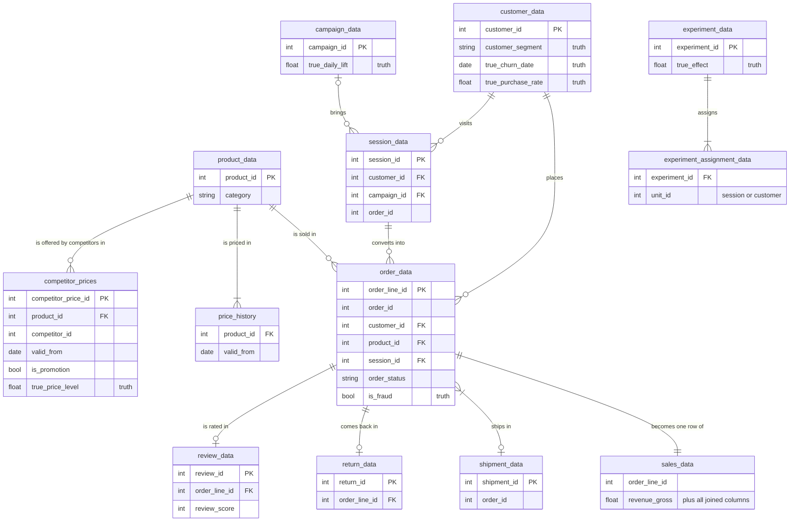

# Data model

The 15 tables of one run and how they link. [columns.md](columns.md) describes every column; the columns marked
"truth" hold what an analysis should find.

Each row of `order_data` is one order line, so `order_id` repeats for multi-line orders, and so does its
`order_status`. Only orders that shipped (`delivered` or `returned`) have a shipment, returns and reviews; cancelled
orders and orders with a failed payment have none. Two tables point at rows of
the others by name instead of a key: `anomaly_data` (fraud rings, shop outages, a return spike, with
`table_name` and dates) and `quality_issue_data` (one row per injected issue, with `table_name`, `key_column` and
`key_value`).

| Table | One row is | Links |
|---|---|---|
| `customer_data` | a customer account | `customer_id` |
| `product_data` | a product | `product_id` |
| `order_data` | an order line | `customer_id`, `product_id`, `session_id`, `campaign_id` |
| `sales_data` | an order line joined with its product and customer | everything in `order_data` |
| `price_history` | a list price of a product with its validity period | `product_id` |
| `competitor_prices` | a list price of a product at one competing shop, with its validity period | `product_id`, `competitor_id` |
| `shipment_data` | the shipment of an order that shipped | `order_id` |
| `return_data` | a returned order line | `order_line_id`, `order_id`, `product_id`, `customer_id` |
| `review_data` | a rating of a delivered order line | `order_line_id`, `order_id`, `product_id`, `customer_id` |
| `campaign_data` | a marketing campaign | `campaign_id` |
| `session_data` | a web session; the converting one has `order_id` | `customer_id`, `campaign_id`, `order_id` |
| `experiment_data` | an A/B experiment | `experiment_id` |
| `experiment_assignment_data` | a session or customer in an experiment | `experiment_id`, `unit_id` |
| `anomaly_data` | a labelled anomaly | `table_name`, `customer_id` for fraud rings |
| `quality_issue_data` | one injected data quality issue | `table_name`, `key_column`, `key_value` |
